# SWP Financial Planner

> **Copyright © 2025 Uddipan Bagchi. All rights reserved.**
> See `LICENSE` in the project root for license information.

A comprehensive retirement-income planning application for Indian investors. It models a 30-year Systematic Withdrawal Plan (SWP) for a **Personal + HUF (Hindu Undivided Family)** dual-entity structure, with tax-optimal fund selection, multi-period portfolio rebalancing via a glide path, Monte Carlo stress testing, and a full PySide6 GUI.

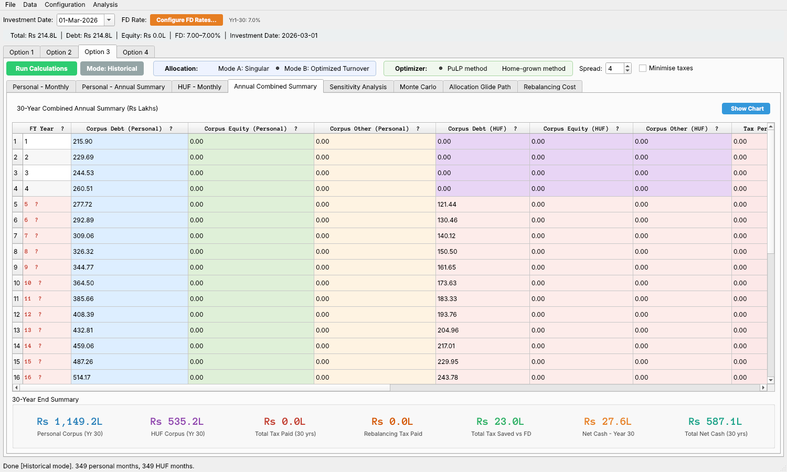

<sub>Screenshots use the synthetic golden test plan (`tests/golden/golden_projects.py`): illustrative figures and generalised fund names, not a real portfolio. Regenerate with `QT_QPA_PLATFORM=offscreen python3 scripts/make_readme_screenshots.py`.</sub>

---

## Table of Contents

1. [High-Level Architecture](#high-level-architecture)
2. [Repository Layout](#repository-layout) · [Module Overview](#module-overview)
3. [Data Flow Diagram](#data-flow-diagram)
4. [Core Data Models (Class Diagram)](#core-data-models-class-diagram)
5. [Portfolio Optimisation Logic](#portfolio-optimisation-logic)
6. [Simulation Engine Logic](#simulation-engine-logic)
7. [Tax Logic](#tax-logic)
8. [Glide Path & Rebalancing](#glide-path--rebalancing)
9. [Monte Carlo Analysis](#monte-carlo-analysis)
10. [Output File Formats](#output-file-formats)
11. [Input File Format: Fund_Metrics_Output.csv](#input-file-format-fund_metrics_outputcsv)
12. [Project Save File Format (.swp.json)](#project-save-file-format-swpjson)
13. [Configuration File](#configuration-file)
14. [Prerequisites & Installation](#prerequisites--installation)
15. [Steps to Execute the Program](#steps-to-execute-the-program)
16. [CLI: allocate_funds.py](#cli-allocate_fundspy)
17. [CLI: get_funds_data.py](#cli-get_funds_datapy)
18. [GUI Walkthrough](#gui-walkthrough)

---

## High-Level Architecture

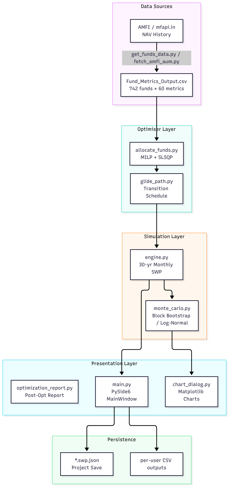

---

## Repository Layout

```
RetirementTaxPlanning/
├── run.py                    # GUI launcher shim (no install needed)
├── pyproject.toml            # package metadata; `pip install -e .`
├── config/RetirementTaxPlanning.configuration
├── src/swp_planner/
│   ├── __main__.py           # python -m swp_planner
│   ├── paths.py              # every on-disk location, in one place
│   ├── config/               # configuration, chunk_defaults
│   ├── core/                 # models, engine, tax/transition/plan logic
│   ├── optimiser/            # allocate_funds, optimization_report
│   ├── simulation/           # monte_carlo, percentile_metrics, nav_feed
│   ├── funddata/             # NAV/AMFI download + metrics CLIs
│   ├── gui/                  # app (launcher), main window, dialogs, charts
│   ├── fund_filters/  ingest/  lookup/  data_synthesizer/
├── scripts/                  # operational CLIs, probes, refresh.sh
├── tests/                    # pytest suite; tests/golden = frozen snapshots
├── db/                       # PostgreSQL schema DDL
├── docs/                     # current design docs; docs/archive/ = superseded versions
├── archive/                  # superseded code kept for reference
├── data/                     # UNTRACKED inputs, caches, logs (see data/README.md)
└── outputs/<user>/           # UNTRACKED per-user GUI output
```

---

## Module Overview

Paths are relative to `src/swp_planner/`.

| File | Role |
|---|---|
| `gui/app.py` | Entry point. Prompts for username, creates `outputs/<user>/`, launches `MainWindow`. |
| `gui/main.py` | PySide6 `MainWindow`. Hosts 4 scenario tabs, all dialogs, calculation orchestration. |
| `core/models.py` | All dataclasses: `AppState`, `FundEntry`, `AllocationChunk`, `GlidePath`, `TaxChunk`, `MonthlyRow`, `YearSummary`, etc. Also: `AppState.from_dict()` / `to_dict()` for JSON persistence. |
| `core/engine.py` | 30-year monthly SWP simulation (per-fund FIFO lot tracking, rebalancing, tax, harvesting). Also `optimize_withdrawal_split()`. |
| `optimiser/allocate_funds.py` | Portfolio optimiser: loads `Fund_Metrics_Output.csv`, runs MILP (PuLP) + SLSQP (SciPy), multi-pass aim/track/frontier-walk strategies, sticky-portfolio Mode A & B. |
| `core/glide_path.py` | Builds the year-by-year weight schedule (`GlidePath`) from chunk `target_weights`, with linear interpolation across transition windows. |
| `simulation/monte_carlo.py` | Sequence-of-returns stress test: Historical Block Bootstrap (preferred) or Log-Normal. Produces `MCResults` with fan-chart percentile bands and ruin probabilities. |
| `config/configuration.py` | Singleton config reader for `config/RetirementTaxPlanning.configuration`. |
| `paths.py` | Project root, `config/`, `data/` sub-folders and `outputs/`; all default paths resolve here. |
| `funddata/get_funds_data.py` | Downloads NAV history from mfapi.in / AMFI; computes rolling CAGR, Sharpe, Sortino, Calmar, Max-DD, Alpha, Beta, Treynor; writes `Fund_Metrics_Output.csv`. |
| `funddata/fetch_amfi_aum.py` | Fetches AMFI AUM data and adds `Fund Size` column to metrics CSV. |
| `funddata/get_amfi_fund_schemes_names.py` | Utility: downloads AMFI master scheme list. |
| `funddata/reclassify_legacy_funds.py` | Utility: reclassifies fund types in saved project JSON. |
| `gui/chunk_editor.py` | Reusable PySide6 widget for editing year-range chunk tables. |
| `gui/dialogs.py` | Various input dialogs (funds, requirements, windfalls, income, splits, returns, sensitivity). |
| `gui/fund_dialog.py` | "View Fund Selection & Allocation" dialog (portfolio stats, fund-level CAGR table). |
| `gui/chart_dialog.py` | Non-modal chart windows: Corpus/Cash bar charts, Sensitivity Analysis, Monte Carlo fan charts. |
| `optimiser/optimization_report.py` | Post-optimisation multi-tab report: Glide Path Summary, Fund Selection, Tax Attribution, Robustness. |
| `gui/tax_dialog.py` | Tax rules editor (slab tables for debt/equity, Personal + HUF). |

---

## Data Flow Diagram

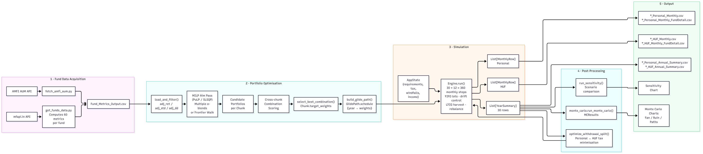
<sub>Click the diagram to open it full size.</sub>


---

## Core Data Models (Class Diagram)

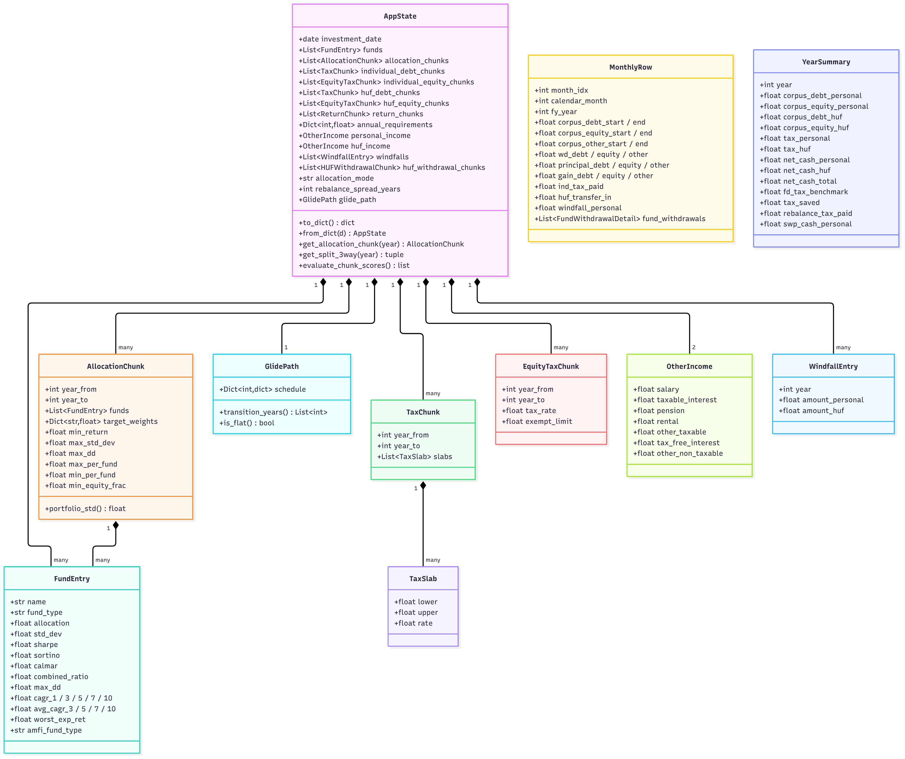
<sub>Click the diagram to open it full size.</sub>


---

## Portfolio Optimisation Logic

The optimiser lives in `optimiser/allocate_funds.py`. Two top-level modes are supported:

### Mode A — Singular (Buy-and-Hold)

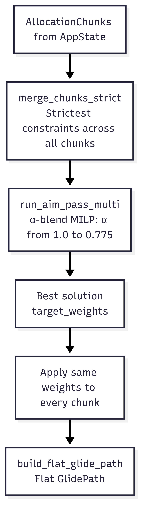

### Mode B — Chunked Sticky (Default)

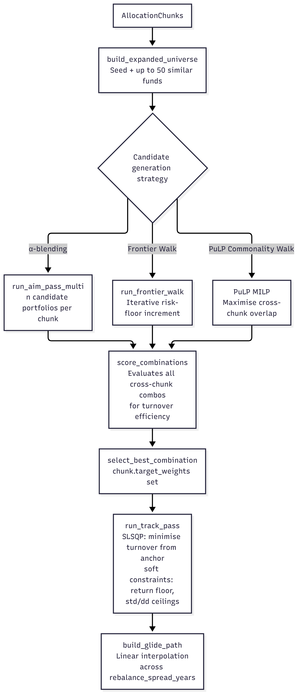

### Optimiser Constraint Hierarchy

The solver uses a **six-step relaxation ladder** — it only relaxes constraints if infeasible at the previous step:

| Step | Constraint relaxed |
|---|---|
| 0 | All constraints tight |
| 1 | Remove per-type cap |
| 2 | Relax `max_dd` |
| 3 | Relax `max_std_dev` |
| 4 | Lower `min_return` |
| 5 | Raise `max_per_fund` |

`min_per_fund` is enforced via **iterative pruning** at every step and is never relaxed.

### Fund Scoring Metrics

| Derived column | Definition |
|---|---|
| `adj_ret` | `min(Avg_CAGR_3Y, Avg_CAGR_5Y, Avg_CAGR_7Y, Avg_CAGR_10Y)` — worst-case rolling average return |
| `adj_std` | `max(Max_Std_Dev_3Y … 10Y)` — worst-case rolling volatility |
| `adj_dd` | `min(Worst_Max_DD_3Y … 10Y)` — worst-case drawdown (most negative) |
| `adj_quality` | `Combined_Ratio` (prefer 5Y → 10Y → 3Y) = `√(Sortino × Calmar)` |

---

## Simulation Engine Logic

`engine.py → Engine.run()` loops over 360 months (30 FYs × 12 months). Each entity (Personal, HUF) maintains **per-fund FIFO lot buckets**.

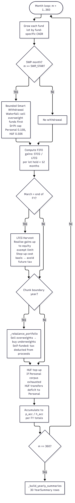

### Withdrawal Waterfall

At each SWP month, the engine withdraws from funds in this priority order:

1. Funds most **overweight** vs. target (drift correction)
2. Within the same drift tier: funds with the **highest individual expected return** (sell the richest first)
3. Respects category allocation (debt/equity/other ratios)

---

## Tax Logic

The engine computes tax annually in April (India FY end). Tax is calculated separately for **Personal** and **HUF** entities.

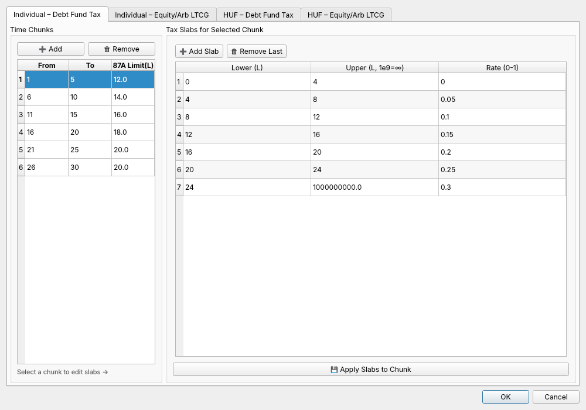

*Configuration → Tax Rules (Individual & HUF): slab tables are defined per block of years (here years 1–5), separately for Personal and HUF debt and equity.*

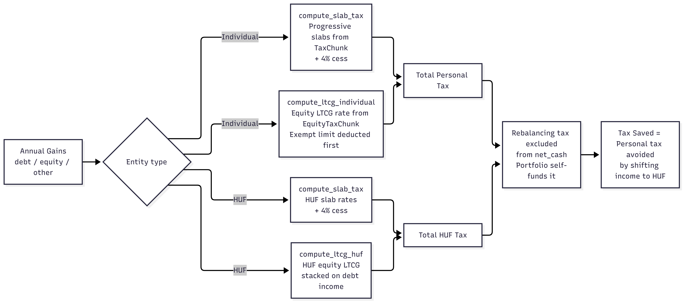

**Tax-Optimal HUF–Personal Split Optimizer** (`optimize_withdrawal_split`): iteratively shifts withdrawal ₹0.25L at a time from Personal to HUF to minimise combined household tax, subject to:
- `min_personal_frac` (≥ 25% personal SWP retained)
- `max_huf_corpus_drain` (≤ 3% HUF corpus per FY)
- `user_cap` (≤ ₹7.5L extra HUF withdrawal per FY)

---

## Glide Path & Rebalancing

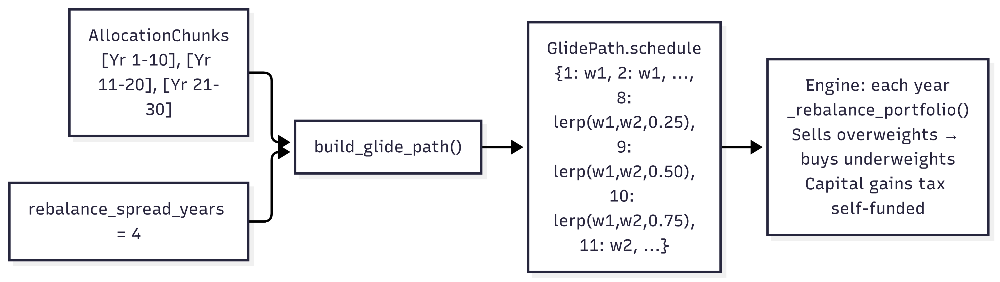

The transition window of `spread_years` is **centred on the chunk boundary**. Because monthly SWP naturally sells overweighted funds first, the glide path rebalancing is mostly accomplished by the normal withdrawal flow — only residual imbalances require explicit sell/buy operations.

---

## Monte Carlo Analysis

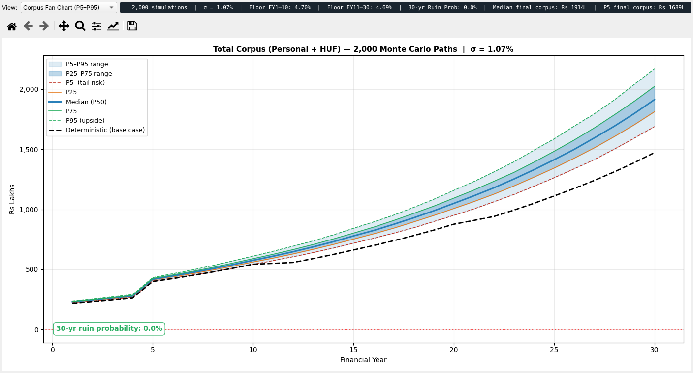

*2,000 block-bootstrap paths of the total corpus. The header strip gives σ, the per-period return floors, ruin probability and the median and P5 final corpus; the View selector also offers a net-cash fan chart, ruin probability by year, sample sequence-of-returns paths and summary statistics.*

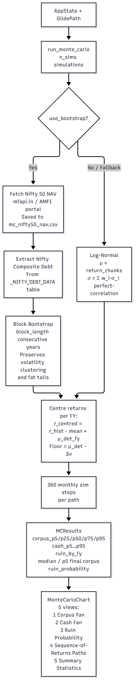

**Blended portfolio return** for each simulated year:

```
r_portfolio = (w_equity + w_other) × r_equity_centred
            +  w_debt              × r_debt_centred
```

"Other" funds (Gold, Hybrid, International) are treated as equity for volatility — a conservative assumption.

---

## Output File Formats

All outputs are written to `<project_root>/outputs/<user_name>/`.

### `*_Personal_Monthly.csv` / `*_HUF_Monthly.csv`
349 rows (months 1–349 of the 30-year plan), 21–23 columns.

| Column | Description |
|---|---|
| `Month#` | Sequential month number (1–349) |
| `Cal Month` | Calendar month label (e.g., `Apr-2025`) |
| `FY Year` | Financial year index (1–30) |
| `Corpus Debt/Eq/Other Start` | Corpus at start of month (₹ lakhs) |
| `WD Debt/Equity/Other/Total` | Gross withdrawal this month |
| `Principal Debt/Equity/Other` | Principal component of withdrawal |
| `Gain Debt/Equity/Other` | Gain component of withdrawal (taxable) |
| `Ind Tax Paid (Apr)` | Tax paid in April (FY-end settlement) |
| `HUF Transfer (Apr)` | Amount transferred from HUF in April |
| `FD Tax Benchmark` | Equivalent tax if invested in FD |
| `Corpus Debt/Eq/Other End` | Corpus at end of month |
| `Windfall Personal` | Windfall received this month |

### `*_Personal_Monthly_FundDetail.csv` / `*_HUF_Monthly_FundDetail.csv`
3822 / 1626 rows (months × funds). Per-fund breakdown.

| Column | Description |
|---|---|
| `Month#`, `Cal Month`, `FY Year` | Time identifiers |
| `Fund Name` | Fund name |
| `Fund Type` | `debt` / `equity` / `other` |
| `Corpus Start` | Fund corpus at start of month |
| `Withdrawal` | Amount withdrawn from this fund |
| `Principal` | Principal component of withdrawal |
| `Gain` | Gain component |
| `Corpus End` | Fund corpus at end of month |

### `*_Personal_Annual_Summary.csv` / `*_HUF_Annual_Summary.csv`
30 rows (one per financial year), 15 columns.

| Column | Description |
|---|---|
| `FY Year` | Financial year index (1–30) |
| `Corpus Debt/Equity/Other (Personal)` | Year-end corpus by category, Personal |
| `Corpus Debt/Equity/Other (HUF)` | Year-end corpus by category, HUF |
| `Tax Personal (L)` | Total personal tax for the year (₹ lakhs) |
| `Tax HUF (L)` | Total HUF tax for the year |
| `Net Cash Personal (L)` | Personal spendable cash (SWP - tax + topup) |
| `SWP Cash Personal (L)` | Raw SWP withdrawal (before tax) |
| `Net Cash HUF (L)` | HUF net cash |
| `Net Cash Total (L)` | Combined household cash |
| `FD Tax Benchmark (L)` | Benchmark: tax if all money were in FD |
| `Tax Saved to HUF (L)` | Tax saved vs. benchmark due to HUF structure |

### `Fund_Metrics_Output.csv`
742 rows (one per fund), 60 columns. Key columns:

| Column | Description |
|---|---|
| `Fund Type` | AMFI regulatory sub-category |
| `Fund Name` | Fund full name |
| `Fund Size` | AUM (₹ crores) |
| `AMFI Code` | Scheme code |
| `Worst_Exp_Ret_%` | Min historical rolling CAGR (conservative return) |
| `Std_Dev_XY` | Annualised std dev over X-year period |
| `Sharpe_XY` | Sharpe ratio |
| `Sortino_XY` | Sortino ratio |
| `Max_DD_XY` | Maximum drawdown |
| `Calmar_XY` | Calmar ratio |
| `Avg_CAGR_XY` | Mean of rolling XY-year CAGRs |
| `Min_CAGR_XY` | Minimum rolling XY-year CAGR |
| `Max_Std_Dev_XY` | Maximum std dev in any rolling XY window |
| `Worst_Max_DD_XY` | Worst drawdown in any rolling XY window |
| `Combined_Ratio_XY` | `√(Sortino × Calmar)` |
| `Alpha_10Y`, `Beta_10Y`, `Treynor_10Y` | Factor metrics vs Nifty 50 |
| `History_Months` | Number of months of NAV history |
| `1Y_CAGR` … `10Y_CAGR` | Point-in-time CAGRs |

---

## Input File Format: Fund_Metrics_Output.csv

This file is the **primary input** to the optimiser. It is generated by `get_funds_data.py` (see [CLI: get_funds_data.py](#cli-get_funds_datapy)).

The GUI reads it from `outputs/<user>/`. The command-line allocator defaults to `data/funds/Fund_Metrics_Output.csv` (the `allocator_default_input` configuration key, relative to the project root).

---

## Project Save File Format (.swp.json)

The application saves and loads the entire `AppState` as a JSON file (`*.swp.json`). Top-level keys:

```json
{
  "investment_date": "2025-04-01",
  "funds": [ { "name": "...", "fund_type": "debt", "allocation": 35.0, ... } ],
  "allocation_chunks": [
    {
      "year_from": 1, "year_to": 10,
      "funds": [...],
      "target_weights": { "Fund Name": 0.07, ... },
      "min_return": 0.0685,
      "max_std_dev": 0.0099,
      "max_dd": 0.0075,
      "max_per_fund": 0.08,
      "min_per_fund": 0.02,
      "min_equity_frac": 0.0
    }
  ],
  "individual_debt_chunks": [ { "year_from": 1, "year_to": 30, "slabs": [...] } ],
  "individual_equity_chunks": [ { "year_from": 1, "year_to": 30, "tax_rate": 0.125, "exempt_limit": 1.25 } ],
  "huf_debt_chunks": [...],
  "huf_equity_chunks": [...],
  "return_chunks": [ { "year_from": 1, "year_to": 30, "annual_return": 0.075 } ],
  "annual_requirements": { "1": 12.0, "2": 12.5, ... },
  "personal_income": { "salary": 0, "taxable_interest": 0, ... },
  "huf_income": { ... },
  "windfalls": [ { "year": 5, "amount_personal": 20.0, "amount_huf": 0.0 } ],
  "huf_withdrawal_chunks": [ { "year_from": 1, "year_to": 30, "annual_withdrawal": 6.0 } ],
  "allocation_mode": "chunked_sticky",
  "rebalance_spread_years": 4
}
```

---

## Configuration File

`config/RetirementTaxPlanning.configuration` — plain `key = value` properties file.

Key parameters (auto-cast to int/float/bool):

| Key | Example | Description |
|---|---|---|
| `cess_rate` | `0.04` | Health & Education Cess (4%) |
| `equity_ltcg_rate` | `0.125` | Equity LTCG flat rate |
| `other_ltcg_rate` | `0.125` | Other (Debt post-2023) LTCG flat rate |
| `stcg_holding_months` | `12` | Holding period threshold for STCG vs LTCG |
| `exit_load_rate` | `0.01` | Exit load for STCG redemptions |
| `drift_cap_personal` | `0.0015` | Max weight drift before forced rebalance (Personal) |
| `drift_cap_huf` | `0.005` | Max weight drift before forced rebalance (HUF) |
| `max_simulation_years` | `30` | Number of FYs to simulate |
| `allocator_default_input` | `data/funds/Fund_Metrics_Output.csv` | Default fund metrics file (relative to project root) |
| `allocator_default_output` | `outputs/allocation_result.csv` | Default allocator output (relative to project root) |

---

## Prerequisites & Installation

**Python:** 3.10 or later

```bash
python -m venv .venv && source .venv/bin/activate
pip install -r requirements-dev.txt     # or requirements.txt without the test tools
pip install -e . --no-deps              # makes `swp_planner` importable everywhere
```

`pip install -e .` is optional: `python run.py`, the scripts and the test suite
all add `src/` to the path themselves. In PyCharm, mark `src/` as a Sources Root.

Moving an existing checkout to this layout: after `git pull`, run
`python3 scripts/migrate_local_layout.py` (dry run) and then with `--apply`
to move untracked inputs, caches and `<user>/` folders into `data/` and `outputs/`.

Optional (for block-bootstrap Monte Carlo):
- `requests` (already listed) — used to fetch Nifty 50 NAV from mfapi.in

**Verify dependencies:**
```bash
python -c "import PySide6, matplotlib, pandas, numpy, scipy, pulp; print('OK')"
```

---

## Steps to Execute the Program

### 1. Generate Fund Metrics (one-time / periodic refresh)

```bash
python -m swp_planner.funddata.get_funds_data
```

This fetches NAV history from mfapi.in for all AMFI-listed funds, computes all 60 metrics, and writes `data/funds/Fund_Metrics_Output.csv` (input: `data/funds/Fund Details.csv`). This can take **20–60 minutes** depending on network speed.

Optionally add AUM data:
```bash
python -m swp_planner.funddata.fetch_amfi_aum
```

### 2. Launch the GUI

```bash
python -m swp_planner      # after pip install -e .
python run.py              # equivalent, from the project root
```

At the welcome dialog, enter your name (e.g., `Uddi`). All outputs will be written to `<project_root>/outputs/Uddi/`.

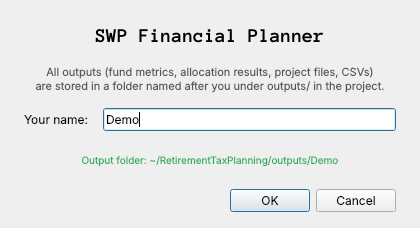

### 3. Typical GUI Workflow

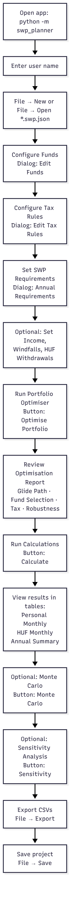

### 4. Command-Line Allocator (single chunk)

```bash
python -m swp_planner.optimiser.allocate_funds \
  --input data/funds/Fund_Metrics_Output.csv \
  --total 500 \
  --min-return 6.85 \
  --max-std-dev 0.99 \
  --max-dd 0.75 \
  --min-history 5 \
  --max-per-fund 7.0 \
  --max-per-type 20.0 \
  --min-per-fund 1.0 \
  --max-fund-std 1.5 \
  --max-fund-dd 1.5 \
  --max-per-amc 16.0 \
  --output allocation_output.csv
```

Or interactively (no arguments):
```bash
python -m swp_planner.optimiser.allocate_funds
```

### 5. Command-Line Allocator (multi-chunk / sticky portfolio)

```bash
python -m swp_planner.optimiser.allocate_funds \
  --input data/funds/Fund_Metrics_Output.csv \
  --chunks-file chunks_config.json \
  --output-dir ./my_allocation/ \
  --mode coarse \
  --frontier-walk
```

Where `chunks_config.json` is an array of chunk objects:
```json
[
  {
    "year_from": 1, "year_to": 10,
    "total": 500,
    "min_return": 6.85, "max_std_dev": 0.99, "max_dd": 0.75,
    "min_history": 5, "max_per_fund": 7.0, "max_per_type": 20.0,
    "min_per_fund": 1.0, "max_fund_std": 1.5, "max_fund_dd": 1.5,
    "max_per_amc": 16.0
  },
  {
    "year_from": 11, "year_to": 20,
    "total": 500,
    "min_return": 6.50, "max_std_dev": 1.20, "max_dd": 1.00,
    ...
  }
]
```

All numeric constraint values in the JSON are in **percentage points** (e.g., `6.85` for 6.85%), not fractions.

---

## CLI: allocate_funds.py

```
usage: python -m swp_planner.optimiser.allocate_funds [-h] [--input INPUT] [--total TOTAL]
                                                      [--chunks-file CHUNKS_FILE] [--output-dir OUTPUT_DIR]
                                                      [--commonality-bonus COMMONALITY_BONUS]
                                                      [--mode {coarse,fine}]
                                                      [--frontier-walk] [--pulp-commonality]
                                                      [--pulp-max-portfolios N] [--pulp-max-std PCT]
                                                      [--risk-ref {portfolio,pct75}]
                                                      [--output OUTPUT]
                                                      [--min-return PCT] [--max-std-dev PCT] [--max-dd PCT]
                                                      [--min-history YRS] [--max-per-fund PCT]
                                                      [--max-per-type PCT] [--min-per-fund PCT]
                                                      [--max-fund-std PCT] [--max-fund-dd PCT]
                                                      [--max-per-amc PCT]
```

**Multi-chunk outputs** (in `--output-dir`):
- `chunk_01.csv`, `chunk_02.csv`, … — per-chunk allocation tables
- `summary.csv` — cross-chunk fund commonality summary
- `portfolio_viz.html` — interactive HTML visualisation of all chunks

**Single-chunk output** (`--output`):
- `allocation_output.csv` — fund allocations with portfolio summary row

---

## CLI: get_funds_data.py

```bash
python -m swp_planner.funddata.get_funds_data [--input CSV] [--output OUTPUT_CSV] [--workers N]
```

Downloads NAV history from `https://api.mfapi.in/mf/{scheme_code}` for all active AMFI schemes, computes rolling metrics, and writes `Fund_Metrics_Output.csv`.

Key metrics computed per fund per time window (3Y, 5Y, 7Y, 10Y):

- **CAGR**: Point-in-time and rolling average/minimum
- **Std Dev**: Annualised from monthly returns (rolling max)
- **Sharpe**: `(CAGR - rf) / std_dev` where `rf` = 6% (repo rate proxy)
- **Sortino**: `(CAGR - rf) / downside_std`
- **Max Drawdown**: Peak-to-trough from NAV series (rolling worst)
- **Calmar**: `CAGR / |Max_DD|`
- **Combined Ratio**: `√(Sortino × Calmar)` — quality composite
- **Alpha, Beta, Treynor**: vs. Nifty 50 Index benchmark

---

## GUI Walkthrough

The main window (`main.py → MainWindow`) has **4 scenario tabs** — each scenario is an independent `AppState`. Shared fields (tax rules, requirements, income) are synchronised across scenarios.

| Dialog / Section | Access | Purpose |
|---|---|---|
| **Edit Funds** | Toolbar button | Add/remove funds, set allocations, import from CSV |
| **Tax Rules** | Toolbar button | Edit slab tables for debt/equity, Personal + HUF |
| **Annual Requirements** | Toolbar button | Set SWP withdrawal targets per FY |
| **Other Income** | Toolbar button | Salary, pension, rental, interest income |
| **Windfalls** | Toolbar button | One-off large inflows in specific years |
| **HUF Withdrawals** | Toolbar button | HUF scheduled withdrawal chunks |
| **Return Assumptions** | Toolbar button | Per-period annual return overrides |
| **Optimise Portfolio** | Toolbar button | Launch MILP+SLSQP optimiser; opens Optimisation Report |
| **Calculate** | Toolbar button | Run engine; populates tables |
| **Monte Carlo** | Toolbar button | Sequence-of-returns stress test; opens fan charts |
| **Sensitivity** | Toolbar button | Multi-scenario return comparison; opens comparison chart |
| **Optimisation Report** | Auto-opens post-optimise | Glide path, fund selection, tax attribution, robustness ranking |
| **Personal Monthly Table** | Main tab | 349-row monthly detail, Personal corpus |
| **HUF Monthly Table** | Main tab | 349-row monthly detail, HUF corpus |
| **Annual Summary Table** | Main tab | 30-row FY summary, both entities |

**Show Chart** above any results table opens a non-modal Matplotlib window; this is the Annual Combined Summary's corpus view:

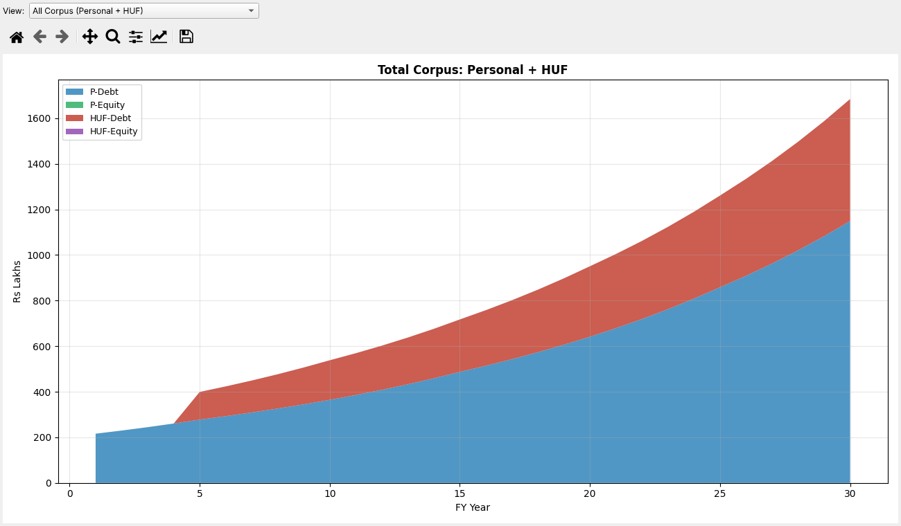

**Configuration → View Fund Selection & Allocation** shows each allocation chunk's funds with their risk/return metrics. Weights are editable in place, and row colour marks whether a fund appears in all, some or one chunk:

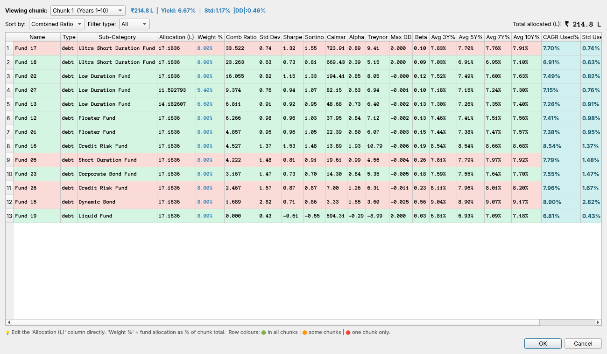

---

*© 2025 Uddipan Bagchi. All rights reserved.*